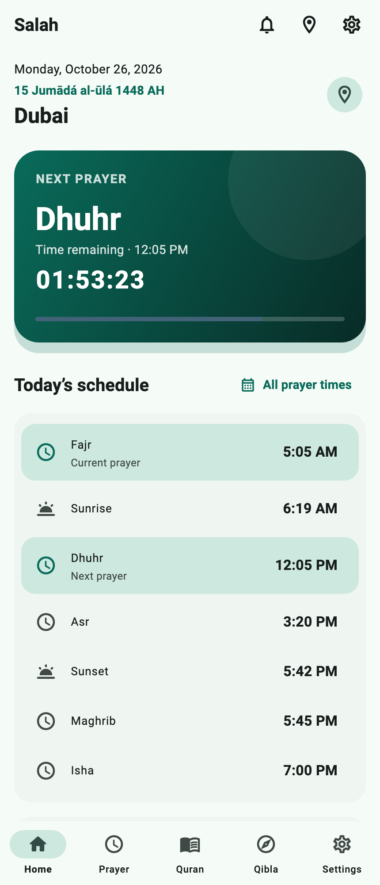
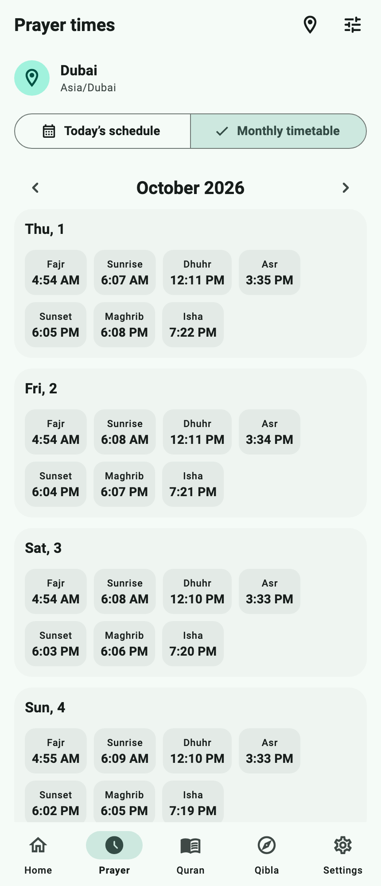
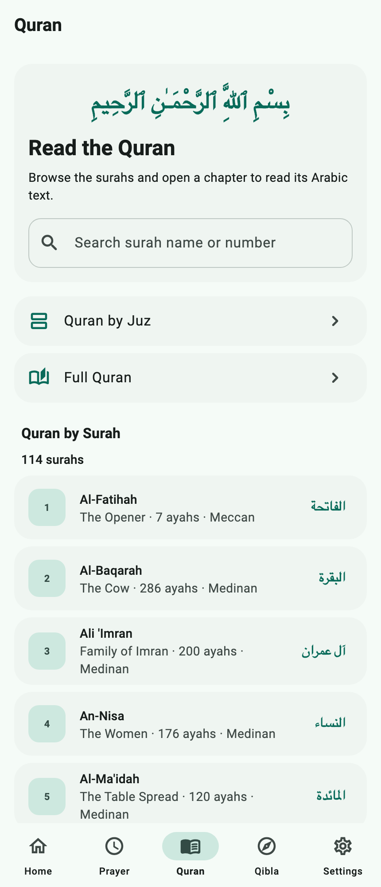
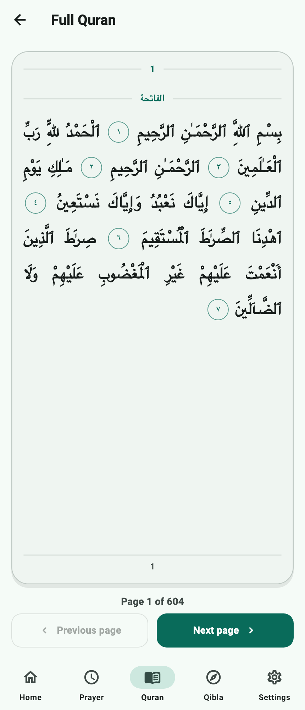
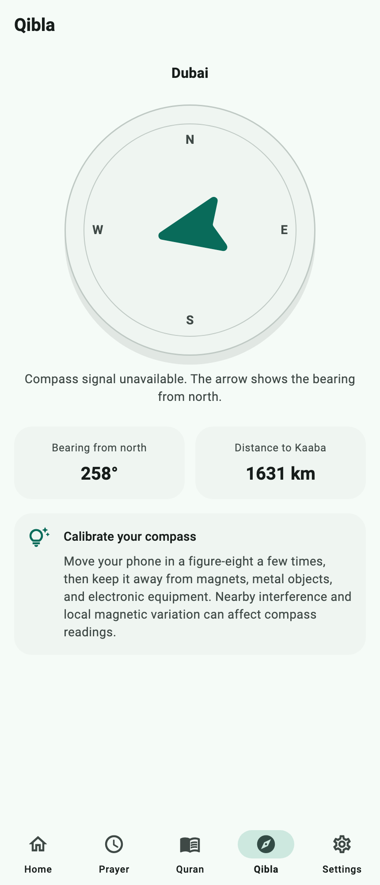
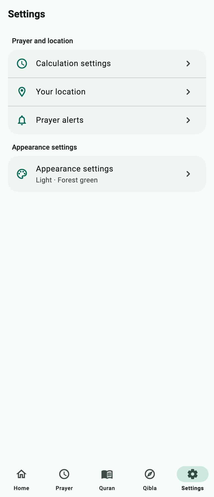

# Salah

Salah is an Android and iOS app that brings Muslim prayer times, Quran reading, and the direction of prayer into one place. **Salah** means the daily Islamic prayer.

Choose your location to see when the next prayer begins, check the month’s timetable, read the Quran in Arabic, or find the direction toward the Kaaba in Makkah. The app has five main tabs: **Home, Prayer, Quran, Qibla, and Settings**. No account is required.

**Project status:** This is a Flutter application under active development. Prayer times, Quran reading, location selection, Qibla, and appearance settings are implemented. The Prayer alerts screen currently saves preferences only; scheduled reminders and Azan audio are still to be built.

## Screenshots

These images show the app’s actual screens, captured with Flutter’s widget renderer using example data for Dubai. Dates and prayer times are illustrative. The Qibla screenshot shows the fallback used when a compass signal is unavailable.

<table>
  <tr>
    <td align="center" valign="top">
      
      <br><strong>Home</strong><br>Today’s prayers and the next-prayer countdown.
    </td>
    <td align="center" valign="top">
      
      <br><strong>Prayer timetable</strong><br>Plan ahead with the monthly schedule.
    </td>
    <td align="center" valign="top">
      
      <br><strong>Quran library</strong><br>Choose how you want to read.
    </td>
  </tr>
  <tr>
    <td align="center" valign="top">
      
      <br><strong>Quran reader</strong><br>Read the Arabic Quran text.
    </td>
    <td align="center" valign="top">
      
      <br><strong>Qibla</strong><br>See the direction and distance to the Kaaba.
    </td>
    <td align="center" valign="top">
      
      <br><strong>Settings</strong><br>Find prayer, location, and appearance controls.
    </td>
  </tr>
</table>

## What the app helps you do

For example, someone living in Dubai can select Dubai, check how long remains until the next prayer, and look up tomorrow’s times. If they travel, they can select their new city or request their device’s current location. They can also open the Quran reader or check the Qibla from the selected place.

| Area | What you can do |
| --- | --- |
| **Home** | See today’s prayer times, the next-prayer countdown, sunrise, sunset, and an Islamic calendar date when available. |
| **Prayer** | Switch between daily and monthly timetables and adjust the calculation settings for your local convention. |
| **Quran** | Find a chapter and read Arabic text by chapter, Juz, or numbered Quran page. |
| **Qibla** | See the direction toward the Kaaba, with a live compass on supported devices. |
| **Location** | Use your device’s location, search for a city, and save places to switch between them. |
| **Settings** | Open prayer and location controls, save alert preferences, and change the app’s appearance. |

### Prayer times and the Home screen

The app shows the five daily prayers: **Fajr** (dawn), **Dhuhr** (midday), **Asr** (afternoon), **Maghrib** (after sunset), and **Isha** (night). Sunrise and sunset are also shown as useful reference times. Sunrise is separate from the five daily prayers.

Home highlights the current and next prayer and displays a countdown to the next prayer’s start. After the final prayer of the day, the next-prayer calculation looks ahead to the following day’s Fajr.

The Prayer tab opens on the monthly timetable, with the current date highlighted. You can switch to today’s schedule or browse other months. Times follow the selected location’s timezone, so a saved city abroad uses that city’s local time.

Open the **Calculation settings** icon on the Prayer screen to change:

- **Calculation method:** One of 13 regional or organizational presets, including Muslim World League, Egyptian, Karachi, Umm al-Qura, Dubai, Qatar, Kuwait, Moonsighting Committee, Singapore, Türkiye, Tehran, North America, and Morocco. These are different conventions for calculating prayer times.
- **Asr calculation:** Standard or Hanafi, which can give different afternoon prayer times.
- **Minute adjustments:** Add or subtract up to 30 minutes for Fajr, sunrise, Dhuhr, Asr, Maghrib, and Isha to accommodate local timetable differences.
- **Time display:** Choose a 12-hour clock, such as `5:30 PM`, or a 24-hour clock, such as `17:30`.

Prayer schedules come from AlAdhan and are saved on the device for reuse. If a needed schedule cannot be fetched, the app can calculate it on the device using the selected location. Online and local calculations may differ. Compare the results with your local mosque’s timetable and select the appropriate calculation settings.

### Location and saved places

Prayer times depend on where you are, so select a location before using the timetable or Qibla screen.

You can choose **Use current location**, which asks the phone for its location while the app is open, or search for a city by name. City search lets you use the app without granting GPS permission. Tap a search result to make it active, and save places you use often so you can select them again later.

The active location is the place currently used for calculations. Saving a city makes it easier to return to; check which place is active after switching or travelling. Request your current location again when you want to update it—the app does not continuously track your movement in the background.

### Quran reading

The Quran section offers three ways to read:

1. **By Surah:** Search the chapter directory by name, English name meaning, or chapter number, then open a chapter.
2. **By Juz:** Select one of the Quran’s 30 reading divisions.
3. **Full Quran:** Move through 604 API-numbered pages using previous and next controls.

The reader displays Arabic Uthmani text from AlQuran Cloud. The full-Quran pages are laid out as text with verse markers; they are not scanned images of a printed book.

**An internet connection is required for Quran content.** English meanings of chapter names appear in the directory, but verse translations are not implemented. Recitation audio, offline downloads, bookmarks, saved reading position, and searching within verse text are also not available yet.

### Qibla direction

**Qibla** is the direction Muslims face during prayer, toward the Kaaba in Makkah. The app calculates this direction from the active location and shows the distance to the Kaaba.

On a phone with a working compass sensor, the dial responds as you turn the phone. Follow the on-screen guidance to align it. If a compass signal is unavailable, the screen still shows the bearing from north. A bearing is an angle measured clockwise from north: `90°` is east, `180°` is south, and `270°` is west.

Use your actual location for a direction that applies to where you are standing. Selecting another city shows the Qibla from that city. The screen includes calibration guidance because magnets, metal objects, and nearby electronics can affect a phone’s compass.

### Calendar and appearance

Home can show both the familiar Gregorian date and a **Hijri date**, the date in the Islamic lunar calendar. Hijri conversion uses AlAdhan’s HJCoSA calendar method. If that service is unavailable, the Hijri line is hidden and the prayer screen continues to work. Local moon-sighting dates may differ from a calculated calendar.

Under **Settings → Appearance**, choose a light theme, dark theme, or the phone’s system theme. Five accent colors are available: forest, teal, indigo, amber, and rose. These choices are saved on the device. The app’s interface is currently in English, with Arabic Quran content.

### Prayer alerts: current limitation

The Prayer alerts screen lets you save an on/off preference for each of the five prayers and may request notification permission when a switch is enabled. **These switches do not yet schedule or deliver reminders. Azan, the call to prayer, is not played.**

## Using the app for the first time

Once a development build is installed:

1. Open Salah and choose **Location** from Home, or from Settings.
2. Tap **Use current location** and grant permission, or search for your city and select a result.
3. Return to **Home** to see today’s schedule and the next-prayer countdown.
4. Open **Prayer**, then its **Calculation settings** icon, to check the method and Asr convention used in your area.
5. Open **Quran** to read, or **Qibla** to check the direction from your active location.
6. Use **Settings → Appearance** to choose your theme and accent color.

If Home asks you to choose a location, no active place has been selected yet. If GPS permission is denied, city search remains an alternative. If Quran content does not load, check your internet connection and use the retry control.

## What works without internet?

| Feature | Offline behavior |
| --- | --- |
| Prayer timetables | Can reuse saved schedules or calculate times locally once a usable location is selected. |
| Next-prayer countdown | Runs locally from the available prayer schedule. |
| Saved locations and preferences | Remain stored on the device and can be reused. |
| Qibla bearing and distance | Calculated locally from the selected coordinates. The live dial also needs a working compass sensor. |
| Finding a new city | Uses the phone’s geocoding service, which may need internet. Resolving GPS coordinates to a place name may also need internet. |
| Quran reading | Requires internet; there is no downloaded offline Quran library yet. |
| Hijri date | Requires the calendar service; the date line may be absent when offline. |

## Data and permissions

The app stores the active location, saved places and their coordinates, prayer preferences, cached prayer schedules, alert preferences, and appearance choices on the device. There is no account or cloud-sync feature in the current implementation.

Location permission is requested when you choose to use the device’s current location. There is no background location tracking. Notification permission may be requested when you enable an alert preference, although reminder delivery is not implemented yet.

Some features contact external services:

- **AlAdhan** receives coordinates or city/address information for prayer-time requests, and Gregorian dates for Hijri conversion.
- **AlQuran Cloud** receives requests for Quran content.
- **The phone’s location and geocoding services** help determine coordinates and find place names.

Saving a place locally does not mean its location information is never sent over the network; remote prayer-time requests use the selected place.

## Development status

The screenshots and feature descriptions above reflect the current implementation. Remaining work includes:

- Scheduling and cancelling prayer notifications, plus Azan audio.
- Quran translations, recitation, offline storage, bookmarks, and reading progress.
- Additional interface languages and Quran reading controls.
- Quran content licensing review before distribution.
- Comparing prayer calculations with trusted local timetables and validating the compass on physical Android and iOS devices.

Timezone selection is automatic and currently has no manual override. Its geographic mapping may need validation near timezone borders. Android and iOS project folders are included; web and desktop targets are not configured.

The repository is a development project rather than a store-ready release. For example, Android still uses the example application ID and debug signing configuration; release configuration remains to be completed.

## Running the project locally

This section is for someone building the app from its source code. **Flutter** is the toolkit used to create the Android and iOS app from one shared codebase, written in **Dart**.

### Requirements

- A Flutter SDK that includes a Dart version compatible with `^3.11.1` (`>=3.11.1` and `<4.0.0`). See [pubspec.yaml](pubspec.yaml) for dependencies.
- For Android: Android Studio or the Android SDK, plus an emulator or a connected Android phone.
- For iOS: macOS with Xcode and CocoaPods, plus an iOS simulator or an appropriately configured iPhone.
- Internet access to download development dependencies and use the online app features.

The current implementation does not require an API key or an environment file.

### Install and launch

From the project’s root directory, run:

```sh
flutter doctor
flutter pub get
flutter devices
flutter run
```

`flutter doctor` reports missing development tools. `flutter pub get` downloads the app’s dependencies. `flutter devices` lists available phones and simulators. `flutter run` builds and launches the app; if several devices are available, select one with `flutter run -d <device-id>`.

### Code checks and localization

```sh
flutter analyze
flutter test
```

These run static code checks and the existing automated tests. The current test suite is a basic startup widget test; it does not validate real-device location, compass accuracy, prayer-time accuracy, or notification delivery.

The existing startup test currently fails because its test environment does not initialize the Shared Preferences storage plugin. It needs a test implementation of that plugin before it can pass.

English interface strings live in [lib/l10n/arb/app_en.arb](lib/l10n/arb/app_en.arb). After editing the source strings or adding a locale, regenerate the localization classes:

```sh
flutter gen-l10n
```

## How the code is organized

The source is grouped by feature. Within a feature, **presentation** contains the screens and their state, **domain** contains the app’s rules and data definitions, and **data** connects those rules to APIs, phone services, and local storage. This keeps screen code separate from the details of fetching and saving information.

```text
lib/
  main.dart          Starts the app
  app/               App setup and navigation
  core/              Shared themes, widgets, errors, and utilities
  features/
    calendar/        Hijri date conversion
    home/            Daily overview and countdown
    location/        Current location, city search, and saved places
    notifications/   Permission handling and saved alert preferences
    prayer/          Timetables, calculations, caching, and settings
    qibla/           Bearing, distance, and compass
    quran/           Quran directory and readers
    settings/        Settings hub
  l10n/              Interface strings and generated translations
```

| Technology | Role in the app |
| --- | --- |
| Flutter / Dart | Build and display the mobile app. |
| Riverpod | Keep track of changing app data and connect screens to services. |
| GoRouter | Handle navigation between tabs and screens. |
| AlAdhan / `adhan_dart` | Supply online prayer schedules and local fallback calculations. |
| `timezone` / `lat_lng_to_timezone` | Find the selected place’s timezone and handle local times. |
| Geolocator / Geocoding | Get device coordinates and look up cities or place names. |
| `flutter_compass` | Read the phone’s compass heading when available. |
| Shared Preferences | Store preferences, locations, and prayer schedule caches on the device. |
| `flutter_local_notifications` | Provide notification initialization and permission handling for the alerts work in progress. |

The app’s entry point is [lib/main.dart](lib/main.dart), its root widget is [lib/app/salah_app.dart](lib/app/salah_app.dart), and its routes are defined in [lib/app/app_router.dart](lib/app/app_router.dart).

## A few terms used in the app

| Term | Plain-language meaning |
| --- | --- |
| Salah | The Islamic daily prayer. |
| Qibla | The direction toward the Kaaba in Makkah, faced during prayer. |
| Surah | A chapter of the Quran. |
| Ayah | A verse of the Quran; **ayahs** means verses. |
| Juz | One of 30 divisions of the Quran used for reading. |
| Mushaf | A written or printed copy of the Quran; here, page-based Quran reading. |
| Hijri | The Islamic lunar calendar. |
| Azan | The call to prayer; audio playback is not implemented in this app yet. |
