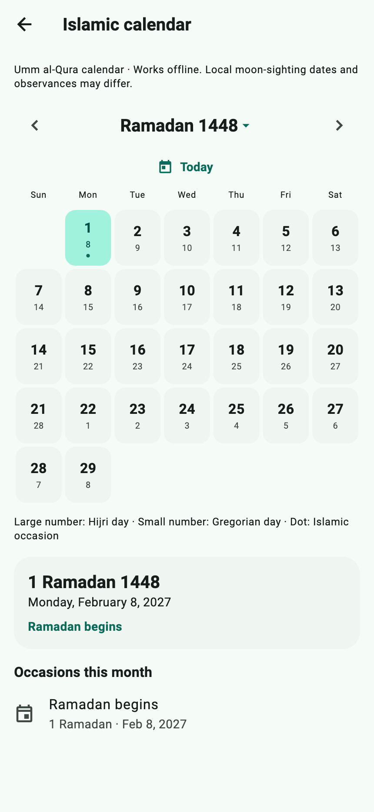
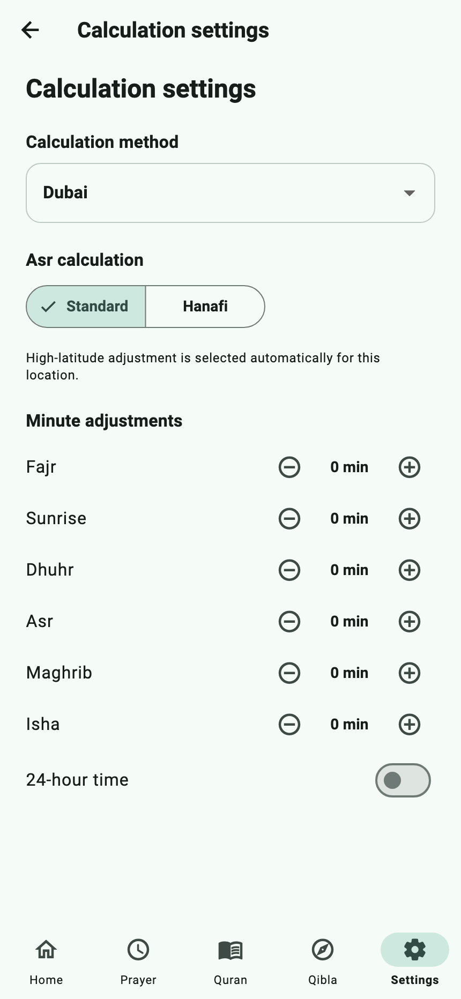
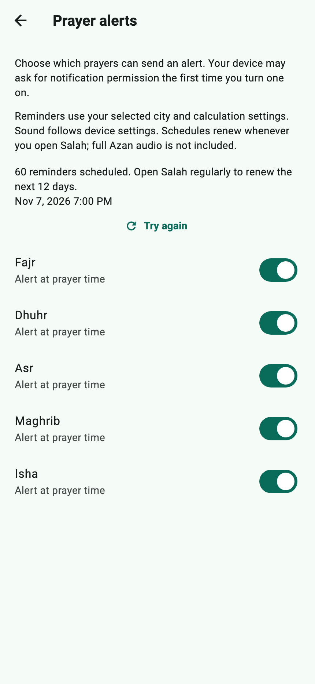

# Salah

Salah is an Android and iOS app that brings Muslim prayer times, Quran reading, Qibla direction, and an Islamic calendar into one place. **Salah** means the daily Islamic prayer.

Choose your location to see when the next prayer begins, check the month’s timetable, read the daily ayah or Quran, find the direction toward the Kaaba in Makkah, and browse the Hijri calendar. The app has five main tabs: **Home, Prayer, Quran, Qibla, and Settings**. No account is required.

**Project status:** Active development for Android and iOS, with English and Arabic interfaces. Implemented features include prayer timetables and scheduled reminders, Ayah of the Day, offline Arabic Quran downloads, reading progress and bookmarks, verse translation and streamed recitation, a Kaaba compass marker, a full offline Hijri calendar, and appearance settings. Full Azan audio is not included.

## Screenshots

These are the app’s actual screens, rendered with local example data for Dubai. Dates, countdowns, download status, and alert counts are illustrative. The calendar shows a browsed month, and Qibla shows the fallback when no compass sensor is available.

<table>
  <tr>
    <td align="center" valign="top">
      
      <br><strong>Home</strong><br>Next prayer and Ayah of the Day.
    </td>
    <td align="center" valign="top">
      
      <br><strong>Islamic calendar</strong><br>Browse Hijri months and occasions offline.
    </td>
    <td align="center" valign="top">
      
      <br><strong>Prayer timetable</strong><br>Daily and monthly prayer times.
    </td>
  </tr>
  <tr>
    <td align="center" valign="top">
      
      <br><strong>Qibla</strong><br>A Kaaba marker shows the prayer direction.
    </td>
    <td align="center" valign="top">
      
      <br><strong>Quran library</strong><br>Downloads, reading progress, and bookmarks.
    </td>
    <td align="center" valign="top">
      
      <br><strong>Quran reader</strong><br>Arabic text with reading controls.
    </td>
  </tr>
  <tr>
    <td align="center" valign="top">
      
      <br><strong>Settings</strong><br>Language, location, and appearance in one place.
    </td>
    <td align="center" valign="top">
      
      <br><strong>Calculation settings</strong><br>Open prayer calculation controls directly.
    </td>
    <td align="center" valign="top">
      
      <br><strong>Prayer alerts</strong><br>Per-prayer reminder preferences and status.
    </td>
  </tr>
</table>

See [the screenshot capture guide](docs/screenshots/README.md) to regenerate this gallery from the current widgets.

## What the app helps you do

For example, someone living in Dubai can select Dubai, check how long remains until the next prayer, and look up tomorrow’s times. If they travel, they can select their new city or request their device’s current location. They can also open the Quran reader or check the Qibla from the selected place.

| Area | What you can do |
| --- | --- |
| **Home** | See the next-prayer countdown, today’s timetable, Hijri date, and Ayah of the Day. |
| **Prayer** | Switch between daily and monthly timetables and adjust the calculation settings for your local convention. |
| **Quran** | Read by Surah, Juz, or page; download Arabic text, resume reading, bookmark ayahs, and access translation or recitation. |
| **Qibla** | Follow the Kaaba marker on the compass, or view the bearing from north without a sensor. |
| **Calendar** | Browse Hijri months and years, select dates, and see Gregorian equivalents and Islamic occasions offline. |
| **Prayer alerts** | Enable reminders for each prayer and check permission and scheduling status. |
| **Location** | Use your device’s location, search for a city, and save places to switch between them. |
| **Settings** | Open calculation controls directly, change location, choose English or Arabic, and adjust appearance. |

### Prayer times and the Home screen

The app shows the five daily prayers: **Fajr** (dawn), **Dhuhr** (midday), **Asr** (afternoon), **Maghrib** (after sunset), and **Isha** (night). Sunrise and sunset are also shown as useful reference times. Sunrise is separate from the five daily prayers.

Home includes an **Ayah of the Day** card with Arabic text, a verse reference, and an English translation when using the English interface. The selected verse stays fixed for the selected city’s civil date (or the device date without a location). Downloaded Arabic Quran text and cached translations work offline. **Read this Surah** opens the reader at that ayah.

Home highlights the current and next prayer and displays a countdown to the next prayer’s start. After the final prayer of the day, the next-prayer calculation looks ahead to the following day’s Fajr.

The Prayer tab opens on the monthly timetable, with the current date highlighted. You can switch to today’s schedule or browse other months. Times follow the selected location’s timezone, so a saved city abroad uses that city’s local time.

Open **Settings → Calculation settings**, or the calculation shortcut on the Prayer screen, to change:

- **Calculation method:** One of 13 regional or organizational presets, including Muslim World League, Egyptian, Karachi, Umm al-Qura, Dubai, Qatar, Kuwait, Moonsighting Committee, Singapore, Türkiye, Tehran, North America, and Morocco. These are different conventions for calculating prayer times.
- **Asr calculation:** Standard or Hanafi, which can give different afternoon prayer times.
- **Minute adjustments:** Add or subtract up to 30 minutes for Fajr, sunrise, Dhuhr, Asr, Maghrib, and Isha to accommodate local timetable differences.
- **Time display:** Choose a 12-hour clock, such as `5:30 PM`, or a 24-hour clock, such as `17:30`.

Prayer schedules come from AlAdhan and are saved on the device for reuse. If a needed schedule cannot be fetched, the app can calculate it on the device using the selected location. Online and local calculations may differ. Compare the results with your local mosque’s timetable and select the appropriate calculation settings.

### Location and saved places

Prayer times depend on where you are, so select a location before using the timetable or Qibla screen. Routine location changes live under **Settings → Your location**; setup and missing-location prompts also take you there.

You can choose **Use current location**, which asks the phone for its location while the app is open, or search for a city by name. City search lets you use the app without granting GPS permission. Tap a search result to make it active, and save places you use often so you can select them again later.

The active location is the place currently used for calculations. Saving a city makes it easier to return to; check which place is active after switching or travelling. Request your current location again when you want to update it—the app does not continuously track your movement in the background.

### Quran reading

The Quran section offers three ways to read:

1. **By Surah:** Search the chapter directory by name, English name meaning, or chapter number, then open a chapter.
2. **By Juz:** Select one of the Quran’s 30 reading divisions.
3. **Full Quran:** Move through 604 API-numbered pages using previous and next controls.

The reader displays Arabic Uthmani text from AlQuran Cloud using a bundled Amiri Quran font. Surah, Juz, and full-Quran reading share a cream-paper layout with ornamental borders, surah banners, and inline numbered verse markers. Tap a verse or its marker to highlight it. Long readings load their page layouts lazily as you scroll. These are text layouts, not scanned images of a printed book.

Use **Download Arabic Quran** in the library to save all 114 Surahs and 604 pages for offline reading. A download is marked ready only after its chapter, verse numbering, page, and Juz metadata pass completeness checks. Downloaded text lives in application support storage; content fetched during reading is also cached. Uninstalling the app removes local content.

Readers automatically restore their saved position. **Continue reading** and **Bookmarks** are in the library. Tap an ayah for bookmark, copy, English translation (Saheeh International), and per-ayah recitation (Mishary Alafasy). Translation text is cached after access; recitation streams and requires internet. Use the text-size button to adjust Arabic text, **Go to ayah** to open a folio containing a verse, or **Go to page** to open a numbered page. Page entry accepts Western, Arabic-Indic, and Persian digits. Searching within verse text remains future work.

### Qibla direction

**Qibla** is the direction Muslims face during prayer, toward the Kaaba in Makkah. The app calculates this direction from the active location and shows the distance to the Kaaba.

On a phone with a working compass sensor, the dial responds as you turn the phone. A vector Kaaba marker sits along the Qibla bearing; turn until it reaches the top of the dial. The marker stays upright and follows the shortest arc when crossing north. If a compass signal is unavailable, the screen still shows the bearing from north. A bearing is an angle measured clockwise from north: `90°` is east, `180°` is south, and `270°` is west.

Use your actual location for a direction that applies to where you are standing. Selecting another city shows the Qibla from that city. The screen includes calibration guidance because magnets, metal objects, and nearby electronics can affect a phone’s compass.

### Islamic calendar and appearance

Open **Islamic calendar** from Home’s calendar button or Settings. The full calendar works offline and supports Hijri years **1356–1500** using bundled Umm al-Qura tables. Browse months, choose a month/year, select a day for its Gregorian date, and return to **Today**. Ramadan, Eid al-Fitr, Arafah, Eid al-Adha, Tashriq, Ashura, and Islamic New Year are marked on their calendar dates. These calculated occasions may differ from local moon-sighting announcements.

Home uses the same conversion as the calendar, so its Hijri date stays consistent. The selected city’s timezone determines today; without a city, the app uses the device date.

Under **Settings → Appearance**, choose a light theme, dark theme, or the phone’s system theme. Five accent colors are available: forest, teal, indigo, amber, and rose. These choices are saved on the device. The interface supports English and Arabic, including right-to-left layout. **Settings → Language** selects English, Arabic, or the device language (other device languages fall back to English).

### Prayer alerts

Enable a switch to schedule local reminders for that prayer. The app requests notification permission on demand. Reminder schedules use your active location and calculation settings and are rebuilt when either changes, when the interface language changes, and when the app resumes.

A rolling window covers the next **12 calendar days**, up to 60 reminders. Open Salah regularly to renew it; reminders stop after that window if the app is not opened. Android restores pending reminders after a reboot. On Android, **Allow precise alarms** opens the relevant permission request; without that permission reminders use an approximate schedule and can be delayed. The alert screen reports permission failures, scheduling errors, and the scheduled count.

Alerts use the device’s normal notification sound and follow its sound settings. Full Azan playback is not implemented. Physical-device delivery, battery restrictions, and compass accuracy still require validation.

## Using the app for the first time

Once a development build is installed:

1. Open Salah and follow the setup guide.
2. Choose **Use current location**, or search for and select a city.
3. Review the calculation method and Asr convention used in your area, then finish setup.
4. On **Home**, check the next prayer or read **Ayah of the Day**. Use the calendar button to browse Hijri dates and occasions.
5. Open **Quran** to read. Use **Download Arabic Quran** if you want Arabic text available offline.
6. Open **Qibla** and turn your device until the Kaaba marker reaches the top of the dial.
7. Use **Settings → Your location** to change cities and **Settings → Calculation settings** to change prayer calculations.
8. Under **Settings**, select your language or appearance and enable reminders in **Prayer alerts**.

If Home asks you to choose a location, no active place has been selected yet. If GPS permission is denied, city search remains an alternative. If Quran content does not load, check your internet connection and use the retry control.

## What works without internet?

| Feature | Offline behavior |
| --- | --- |
| Prayer timetables | Can reuse saved schedules or calculate times locally once a usable location is selected. |
| Next-prayer countdown | Runs locally from the available prayer schedule. |
| Saved locations and preferences | Remain stored on the device and can be reused. |
| Qibla bearing and distance | Calculated locally from the selected coordinates. The live dial also needs a working compass sensor. |
| Finding a new city | Uses the phone’s geocoding service, which may need internet. Resolving GPS coordinates to a place name may also need internet. |
| Quran reading | Download the complete Arabic Quran first, or reuse previously cached readings. Translation text is cached after access; recitation requires internet. |
| Hijri calendar | Full month browsing, Gregorian conversion, and listed occasions work offline. |

## Data and permissions

The app stores the active location, saved places and their coordinates, prayer preferences, cached prayer schedules, alert preferences, downloaded Quran content, bookmarks, reading progress, language, and appearance choices on the device. There is no account or cloud-sync feature in the current implementation.

Location permission is requested when you choose to use the device’s current location. There is no background location tracking. Notification permission is requested when you enable an alert. Android may also request precise-alarm permission when you choose that option.

Some features contact external services:

- **AlAdhan** receives coordinates or city/address information for prayer-time requests. Hijri calendar conversion now runs on the device.
- **AlQuran Cloud** receives requests for Quran content.
- **The phone’s location and geocoding services** help determine coordinates and find place names.

Saving a place locally does not mean its location information is never sent over the network; remote prayer-time requests use the selected place.

## Development status

The screenshots and feature descriptions above reflect the current implementation. Remaining work includes:

- Full Azan audio and reminder renewal beyond the rolling schedule.
- Additional Quran translation/reciter choices, audio downloads, and searching verse text.
- Additional interface languages.
- Quran content licensing review before distribution.
- Comparing prayer calculations with trusted local timetables and validating the compass on physical Android and iOS devices.

Timezone selection is automatic and currently has no manual override. Its geographic mapping may need validation near timezone borders. Android and iOS project folders are included; web and desktop targets are not configured.

The repository is a development project rather than a store-ready release. For example, Android still uses the example application ID and debug signing configuration; release configuration remains to be completed.

## Running the project locally

This section is for someone building the app from its source code. **Flutter** is the toolkit used to create the Android and iOS app from one shared codebase, written in **Dart**.

### Requirements

- A Flutter SDK that includes a Dart version compatible with `^3.11.1` (`>=3.11.1` and `<4.0.0`). See [pubspec.yaml](pubspec.yaml) for dependencies.
- For Android: Android Studio or the Android SDK, plus an emulator or a connected Android phone.
- For iOS: macOS with Xcode and CocoaPods, plus an iOS simulator or an appropriately configured iPhone.
- Internet access to download development dependencies and use the online app features.

The current implementation does not require an API key or an environment file.

### Install and launch

From the project’s root directory, run:

```sh
flutter doctor
flutter pub get
flutter devices
flutter run
```

`flutter doctor` reports missing development tools. `flutter pub get` downloads the app’s dependencies. `flutter devices` lists available phones and simulators. `flutter run` builds and launches the app; if several devices are available, select one with `flutter run -d <device-id>`.

### Code checks and localization

```sh
flutter analyze
flutter test
```

These run static code checks and the existing automated tests. Tests include a basic startup widget test and Quran reader presentation checks for Bismillah rules, verse selection, pagination, lazy rendering, and responsive layouts. Additional tests cover monthly API parsing, stale requests, damaged caches, offline fallback, midnight rollover, timezone date selection, notification replacement/cancellation, persistent Quran storage, reading progress, bookmark actions, page entry, calculation-settings navigation, Hijri month conversion and year boundaries, daily-ayah selection and retry, Kaaba-marker positioning, and English/Arabic layouts at large text sizes. They do not validate real-device location, compass accuracy, prayer-time accuracy against a mosque timetable, or notification delivery.

The test harness uses the official in-memory Shared Preferences implementation, so startup and persistence tests do not depend on native plugin registration.

Interface strings live in [app_en.arb](lib/l10n/arb/app_en.arb) and [app_ar.arb](lib/l10n/arb/app_ar.arb). After editing the source strings or adding a locale, regenerate the localization classes:

```sh
flutter gen-l10n
```

## How the code is organized

The source is grouped by feature. Within a feature, **presentation** contains the screens and their state, **domain** contains the app’s rules and data definitions, and **data** connects those rules to APIs, phone services, and local storage. This keeps screen code separate from the details of fetching and saving information.

```text
lib/
  main.dart          Starts the app
  app/               App setup and navigation
  core/              Shared themes, widgets, errors, and utilities
  features/
    calendar/        Offline Hijri month calendar and date conversion
    home/            Prayer overview, countdown, and daily ayah
    location/        Current location, city search, and saved places
    notifications/   Permissions, reminder scheduling, and preferences
    prayer/          Timetables, calculations, caching, and settings
    qibla/           Bearing, distance, and compass
    quran/           Readers, downloads, bookmarks, translation, and recitation
    settings/        Settings hub
  l10n/              Interface strings and generated translations
```

| Technology | Role in the app |
| --- | --- |
| Flutter / Dart | Build and display the mobile app. |
| Riverpod | Keep track of changing app data and connect screens to services. |
| GoRouter | Handle navigation between tabs and screens. |
| AlAdhan / `adhan_dart` | Supply online prayer schedules and local fallback calculations. |
| `timezone` / `lat_lng_to_timezone` | Find the selected place’s timezone and handle local times. |
| Geolocator / Geocoding | Get device coordinates and look up cities or place names. |
| `flutter_compass` | Read the phone’s compass heading when available. |
| Shared Preferences | Store preferences, locations, and prayer schedule caches on the device. |
| `flutter_local_notifications` | Request notification permissions and schedule, replace, or cancel prayer reminders. |
| `hijri` | Supply offline Umm al-Qura date conversion and month lengths. |
| `path_provider` | Locate persistent storage for Quran downloads and cached content. |
| `audioplayers` | Stream per-ayah recitation. |

The app’s entry point is [lib/main.dart](lib/main.dart), its root widget is [lib/app/salah_app.dart](lib/app/salah_app.dart), and its routes are defined in [lib/app/app_router.dart](lib/app/app_router.dart).

## A few terms used in the app

| Term | Plain-language meaning |
| --- | --- |
| Salah | The Islamic daily prayer. |
| Qibla | The direction toward the Kaaba in Makkah, faced during prayer. |
| Surah | A chapter of the Quran. |
| Ayah | A verse of the Quran; **ayahs** means verses. |
| Juz | One of 30 divisions of the Quran used for reading. |
| Mushaf | A written or printed copy of the Quran; here, page-based Quran reading. |
| Hijri | The Islamic lunar calendar. |
| Azan | The call to prayer; full Azan playback is not included. Quran recitation is available separately. |
